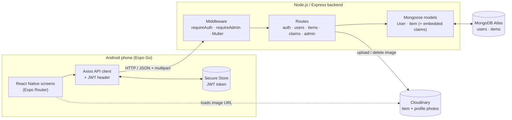
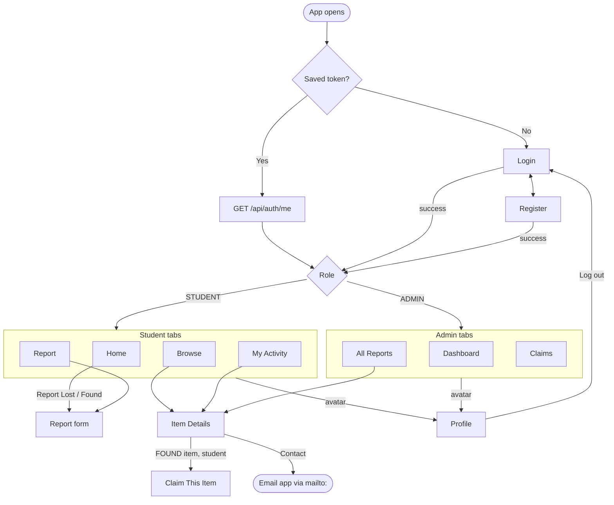
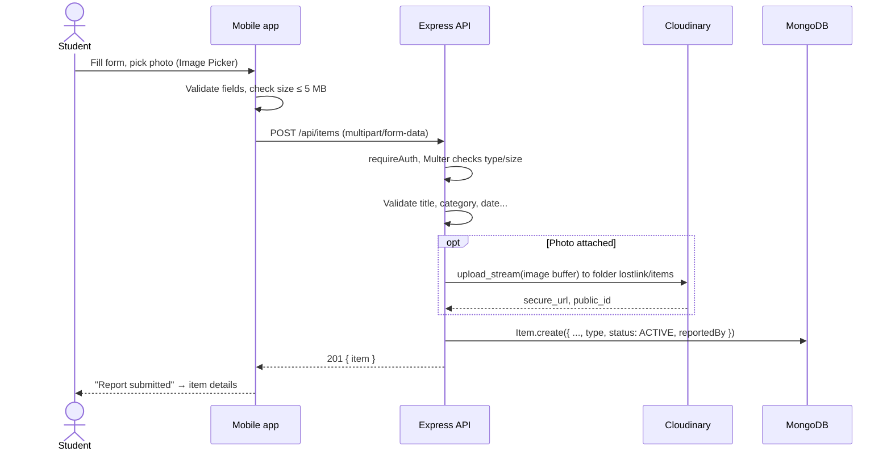
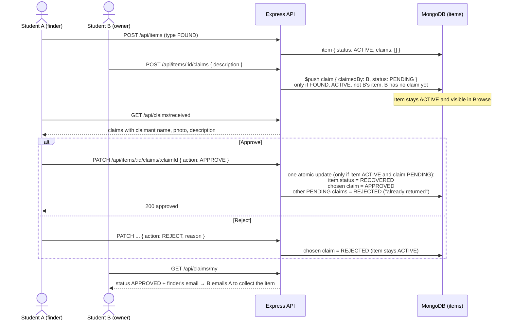
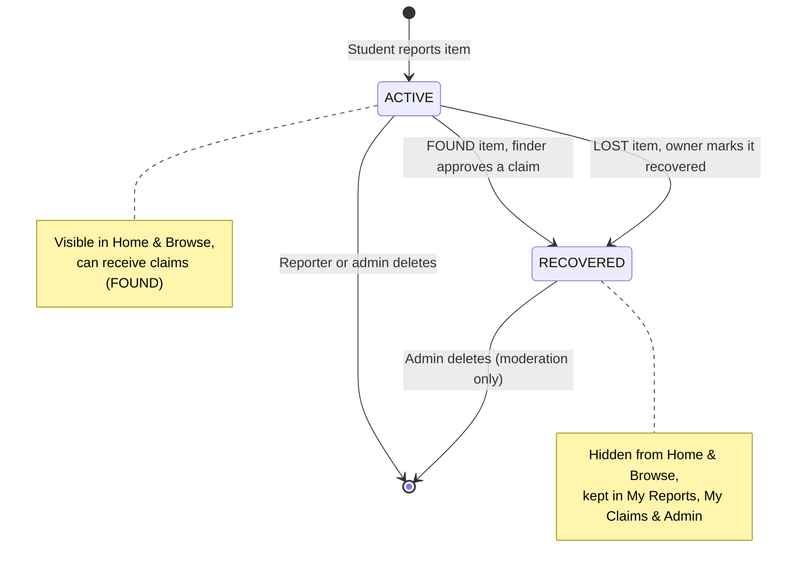
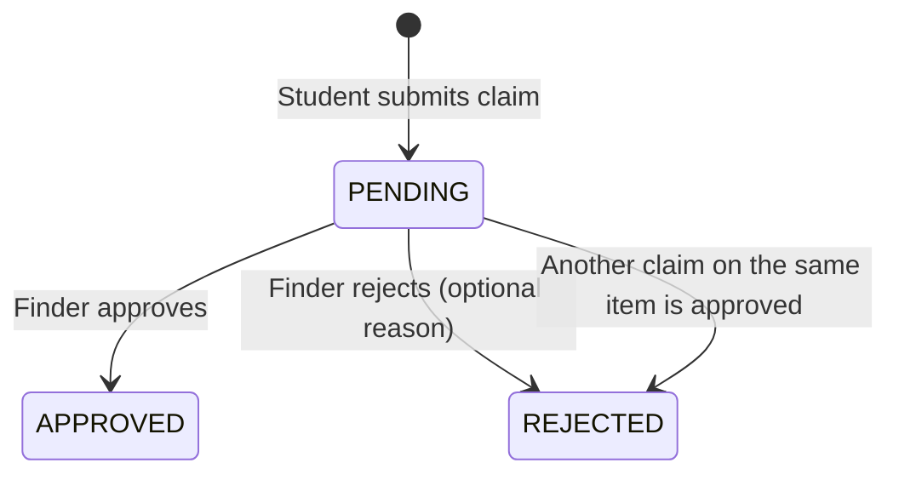
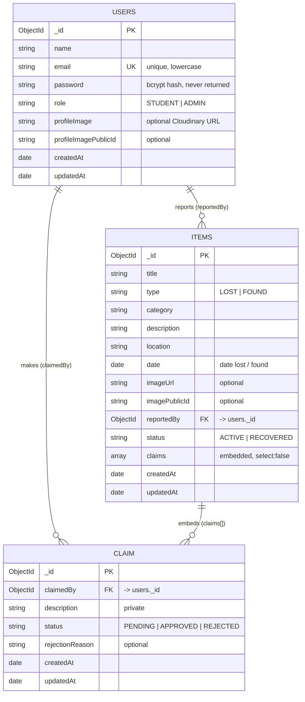

# LostLink – Campus Lost & Found Management System

**Mini-Project Report — Final Year, Computer Engineering**

---

## Table of Contents

1. [Introduction](#1-introduction)
2. [Abstract](#2-abstract)
3. [Problem Statement](#3-problem-statement)
4. [Objectives](#4-objectives)
5. [Technology Stack](#5-technology-stack)
6. [System Architecture](#6-system-architecture)
7. [User Roles and Application Features](#7-user-roles-and-application-features)
8. [Database Design](#8-database-design)
9. [API Endpoint Documentation](#9-api-endpoint-documentation)
10. [Installation Instructions](#10-installation-instructions)
11. [Testing Procedure](#11-testing-procedure)
12. [Conclusion](#12-conclusion)
13. [Future Enhancements](#13-future-enhancements)

---

## 1. Introduction

Every college campus has a steady flow of misplaced belongings: ID cards left in the library, calculators forgotten in labs, wallets dropped in the canteen. At VJTI, as on most campuses, these are usually handled through notice boards, word of mouth or scattered messaging groups, so many items are never returned. When an item *is* found, the finder has no reliable way to check that the person asking for it is the real owner.

**LostLink** is an Android mobile application that gives students one shared place to:

- report lost items and found items,
- browse what others have reported,
- **claim** a found item by proving ownership, and
- let the finder approve the right claimant before handing the item over.

The application is a full-stack system:

- A **React Native (Expo)** mobile app that students install and use.
- A **Node.js / Express** REST API that handles authentication, validation and business rules.
- A **MongoDB Atlas** cloud database that stores users and item reports (with claims embedded in the items).
- **Cloudinary** cloud storage for item photos and profile photos.

---

## 2. Abstract

LostLink is a campus lost-and-found management application built with React Native, Expo and TypeScript on the client side and Node.js, Express, MongoDB and Cloudinary on the server side.

- **Accounts.** Students register and log in with an email and password, optionally adding a profile photo. Passwords are hashed with bcrypt. Sessions use JSON Web Tokens stored in the device's secure storage.
- **Reporting.** Authenticated students report lost or found items with a name, category, description, location, date and an optional photo. Photos are uploaded through the backend to Cloudinary, and only the resulting URL is stored in the database.
- **Browsing.** Active reports can be browsed, filtered by type and searched by name or category.
- **Claims.** A student who recognises a found item submits a claim describing private identifying details. The student who reported the item reviews the claims and approves one or rejects them. Approving a claim marks the item as recovered and automatically closes all other pending claims. This is a single atomic database update, so two owners can never be approved for the same item.
- **Administration.** An administrator account, created only through a seed script, sees dashboard statistics, moderates all reports and can inspect pending claims, but cannot decide ownership.
- **Data model.** Deliberately minimal: exactly two collections (Users and Items), with claims stored as an embedded array inside each item.

---

## 3. Problem Statement

On a typical campus:

- There is **no central record** of lost or found items. Information is spread across notice boards, security desks and chat groups.
- A student who finds an item has **no easy way to reach the owner**, and the owner does not know where to look.
- When several people say an item is theirs, the finder has **no structured way to verify ownership**, so items can be handed to the wrong person.
- Messages in chat groups are **quickly buried** and cannot be filtered or searched.
- There is **no accountability**: anyone can post anything, and nobody can remove misleading posts.

**The problem is to design and build a simple, secure mobile application that lets students report and discover lost and found items on campus, verify ownership before an item is returned, and keep the list of reports accurate and moderated.**

---

## 4. Objectives

1. Provide secure **student registration and login** with hashed passwords, token-based sessions and optional profile photos.
2. Allow students to **report lost items and found items** with descriptive details and an optional photo.
3. Store photos in **cloud storage (Cloudinary)** while keeping credentials on the server only.
4. Let students **browse and search active reports** and filter them by ALL / LOST / FOUND.
5. Provide an **ownership-claim workflow**: students claim found items, and only the finder approves or rejects claims.
6. Guarantee that **only one claim can ever be approved per item**, even if requests arrive at the same time.
7. Keep **recovered items in the database** as a record while hiding them from active listings.
8. Ensure **authorization is enforced on the server**: ownership checks, finder-only claim review and admin-only routes.
9. Provide an **administrator dashboard** for statistics and moderation, without giving admins the power to decide ownership.
10. Keep the system **simple and explainable**: two database collections, straightforward REST routes, a consistent VJTI-inspired UI.

---

## 5. Technology Stack

| Layer | Technology | Purpose |
|---|---|---|
| Mobile app | React Native + Expo (SDK 58) | Cross-platform mobile UI, runs in Expo Go on Android |
| Language | TypeScript | Type safety on both mobile and backend |
| Navigation | Expo Router | File-based navigation (stack + bottom tabs) |
| HTTP client | Axios | API requests with automatic JWT header |
| Image selection | Expo Image Picker | Choose a photo from the phone's gallery |
| Token storage | Expo Secure Store | Encrypted on-device storage for the JWT |
| Date input | @react-native-community/datetimepicker | Native Android date picker |
| Backend runtime | Node.js | Server-side JavaScript runtime |
| Web framework | Express.js 5 | REST API routing and middleware |
| Database | MongoDB Atlas | Cloud-hosted document database |
| ODM | Mongoose | Schemas, validation and queries for MongoDB |
| Authentication | jsonwebtoken (JWT) | Stateless login sessions (7-day tokens) |
| Password hashing | bcryptjs | One-way salted password hashes |
| Image hosting | Cloudinary | Cloud storage and delivery of item and profile photos |
| File upload parsing | Multer | Reads multipart image uploads into memory |
| Configuration | dotenv | Loads secrets from a `.env` file |
| CORS | cors | Allows the mobile app to call the API |
| API testing | Postman | Manual testing of REST endpoints |

---

## 6. System Architecture

LostLink follows a **three-tier client–server architecture**. The mobile app never talks to the database or to Cloudinary directly. Everything passes through the backend, which validates every request.



### Backend structure

```
backend/
├── server.ts                 Entry point: loads .env, connects DB, listens on 0.0.0.0
├── app.ts                    Express app: middleware, routers, central error handler
├── config/
│   ├── database.ts           MongoDB connection
│   └── cloudinary.ts         Cloudinary setup, upload (item/profile) & delete helpers
├── models/
│   ├── User.ts               User schema (name, email, password, role, profileImage)
│   └── Item.ts               Item schema with embedded claim sub-schema
├── middleware/
│   ├── authMiddleware.ts     JWT verification (requireAuth), admin check (requireAdmin)
│   └── uploadMiddleware.ts   Multer: one optional image, type & size limits
├── routes/
│   ├── authRoutes.ts         /api/auth/*        register, login, me
│   ├── userRoutes.ts         /api/users/*       profile name and photo
│   ├── itemRoutes.ts         /api/items/*       report, list, details, recover, delete
│   ├── claimRoutes.ts        /api/items/:id/claims*, /api/claims/*   claim workflow
│   └── adminRoutes.ts        /api/admin/*       stats, moderation, pending claims
├── utils/validation.ts       Shared input helpers (asString, isValidId, email pattern)
└── scripts/seedAdmin.ts      Creates or updates the admin account
```

### Mobile structure

```
mobile/src/
├── app/                      Expo Router screens (each file is a route)
│   ├── _layout.tsx           Root stack + role-based guards (Stack.Protected)
│   ├── index.tsx             Redirects to Login, Student Home or Admin Dashboard
│   ├── login.tsx, register.tsx
│   ├── (student)/            Student tabs: home, browse, report, activity
│   ├── (admin)/              Admin tabs: dashboard, all-reports, claims
│   ├── report/[type].tsx     Report Lost / Report Found form (students only)
│   ├── claim/[id].tsx        Claim submission form (students only)
│   ├── item/[id].tsx         Item details; the finder also reviews claims here
│   └── profile.tsx           Profile, opened from the top-right avatar
├── components/               Button, TextField, ItemCard, ItemImage, ClaimCard, AdminClaimCard,
│                             Avatar, HeaderAvatar, StatCard, Segmented, StatusBadge, StateViews,
│                             ImagePickerSheet, PhotoField, KeyboardAvoider, CategoryIcon, tabBar
│   └── activity/             MyReportsList, MyClaimsList, ClaimsReceivedList
├── context/AuthContext.tsx   Login state, Secure Store session, profile updates
├── lib/                      api.ts (Axios client), pickImage.ts (camera / gallery), useClaimReview.ts,
│                             useAdminDelete.ts, useFocusData.ts, email.ts, format.ts
├── constants.ts              Design system colours, status colours, categories, Home photo
└── types.ts                  Shared TypeScript types
```

### Security design

- **Passwords** are hashed with bcrypt (10 salt rounds). The `password` field is excluded from all queries by default (`select: false`) and never sent to the app.
- **JWT** tokens are signed with a server-side secret, expire after 7 days and are stored in Expo Secure Store. A `401` from any protected route logs the user out automatically.
- **Authorization** happens on the server:
  - `requireAuth` protects every item, claim and profile route;
  - ownership checks run before an item is updated or deleted;
  - claim review is allowed only for the item's reporter;
  - `requireAdmin` protects every admin route.
- **Admin accounts** cannot be created through registration, because the role field is never read from a request body.
- **Claim privacy:** the `claims` array is marked `select: false` in the Item schema, so it never appears in Browse, Home, item details or admin item lists. Only `GET /items/:id/claims` (reporter only) and `GET /claims/my` (the claimant's own claim) return claim descriptions. The admin claims list omits the description.
- **Race-free approvals:** approving, rejecting and submitting claims are each one conditional `findOneAndUpdate`, which MongoDB applies atomically to a single document.
- **Cloudinary credentials** exist only in the backend `.env`.
- **Errors** are logged on the server, while the client only receives a short message (no stack traces).

---

## 7. User Roles and Application Features

### 7.1 User roles

| Role | How it is created | Can do |
|---|---|---|
| `STUDENT` | Registration in the app | Report items, browse, claim FOUND items, review claims on items they reported, manage own reports and profile |
| `ADMIN` | `npm run seed:admin` only | Everything a student can view, plus dashboard statistics, delete any report, view pending claims (read-only). Cannot submit, approve or reject claims. |

"Reporter" and "claimant" are not roles. They describe a student's relationship to a particular item.

### 7.2 Role-based interfaces

Students and administrators get **two different apps** inside LostLink. The role comes from the user object returned by the backend (`/auth/login` or `/auth/me`), never from the app itself.

| | Student | Administrator |
|---|---|---|
| Lands on after login / app restart | Home | Admin Dashboard |
| Bottom tabs | Home · Browse · Report · My Activity | Dashboard · All Reports · Claims |
| Profile | Avatar button at the top-right | Avatar button at the top-right |
| Can report and claim items | Yes | No |
| Can review claims | Only on items they found | No (read-only view) |

**How it is enforced.** `src/app/_layout.tsx` wraps each group of screens in `Stack.Protected`:

- logged-out users: only Login and Register;
- `STUDENT`: the `(student)` tabs, the report form and the claim form;
- `ADMIN`: the `(admin)` tabs;
- any logged-in user: Item Details and Profile.

If a guard is false, those screens do not exist for the user, so a deep link or a manual route cannot open them. Instead the user is sent to `index.tsx`, which redirects to the right starting screen for their role. While the saved session is being restored, a loading screen is shown, so the wrong interface never flashes on screen. The backend checks the role again on every request.

### 7.3 Screens

| Screen | Purpose |
|---|---|
| Login / Register | Account access; show/hide password; optional profile photo at registration; the keyboard never covers the active field |
| Home (student) | Faded VJTI campus photo, welcome, coral Report Lost / green Report Found shortcuts, active lost/found counts, recent reports |
| Browse (student) | Active items only, All / Lost / Found filter, search by name or category |
| Report (student) | Highlighted centre tab; choose Report Lost or Report Found, then fill in the form with an optional photo |
| My Activity (student) | Three sections: **My Reports**, **My Claims**, **Claims Received** (approve / reject) |
| Item Details | Full report, contact button, **Claim This Item** (students, found items), own claim status, and for the finder the claims with Approve / Reject |
| Claim This Item | Form where the claimant explains why the item is theirs |
| Profile | Photo (Camera / Gallery, preview, save or cancel, remove), editable name, email, role, logout |
| Dashboard (admin) | Total users, active lost, active found, recovered; recent reports; pending claims |
| All Reports (admin) | Every report (All / Active / Recovered) with View Details and Delete |
| Claims (admin) | Pending or all claims with item, claimant, finder, date and status; read-only |

**Choosing an image.** Every photo goes through the same "Choose an Image" bottom sheet: item photos on the report forms, the profile photo at registration, and the photo on the Profile screen. The sheet offers **Camera** (take a new photo) and **Gallery** (pick an existing one). Both are handled by one function, `lib/pickImage.ts`, which:

- asks for camera permission;
- explains what to do if permission is refused, with an "Open Settings" button when Android will not ask again;
- lets the user crop the image;
- rejects files that are too large or are not images.

The chosen photo is previewed with Retake / Remove (report form) or Save / Cancel (profile) before it is uploaded.

**Keyboard handling.** Expo apps on Android draw edge-to-edge, so the window no longer shrinks when the keyboard opens. Every form is therefore wrapped in `KeyboardAvoider`, which is a `KeyboardAvoidingView` with `behavior="padding"` and the header height as offset, around a `ScrollView`. The scroll view then shrinks to the space above the keyboard and scrolls the focused field into view.

### 7.3.1 Screen navigation



### 7.4 Reporting an item with a photo (Cloudinary upload)



**How image upload works:**

1. The app picks an image with Expo Image Picker (compressed to 70% quality).
2. The image is sent to the backend as `multipart/form-data`.
3. Multer keeps the file in memory (no temporary files) and rejects anything that is not JPG/PNG/WEBP/HEIC or is over 5 MB.
4. The backend streams the buffer to Cloudinary and stores only `secure_url` and `public_id` in MongoDB. Profile photos are cropped to 400×400 around the face by Cloudinary.
5. The `public_id` is used to delete the old image when a profile photo is replaced or removed, or when a report is deleted.

### 7.5 Claim management workflow



**Rules enforced on the server:**

| Rule | Where it is enforced |
|---|---|
| Only `STUDENT` accounts can claim | Role check before the update |
| Only FOUND, ACTIVE items can be claimed | Part of the update filter |
| A student cannot claim their own report | `reportedBy: { $ne: user }` in the filter |
| One claim per student per item | `'claims.claimedBy': { $ne: user }` in the filter |
| Claim description 10–1000 characters | Request validation + schema |
| Only the reporter can view or review claims | `reportedBy: user` in the filter / explicit check |
| Only a PENDING claim on an ACTIVE item can be reviewed | `claims: { $elemMatch: { _id, status: PENDING } }, status: ACTIVE` in the filter |
| Only one approval per item, ever | Approval sets `status: RECOVERED` in the same atomic update; any later approval no longer matches `status: ACTIVE` and gets `409` |
| Other pending claims are closed on approval | `arrayFilters` update in the same statement |
| Admins cannot approve/reject | No admin review route; the admin is not the reporter, so `403` |

If the conditional update matches nothing, the server reads the item once more to send a precise message (e.g. `404 Item not found`, `409 This item has already been recovered`, `409 This claim has already been rejected`).

### 7.6 Item lifecycle



### 7.7 Claim lifecycle



### 7.8 Visual design

All colours are defined once in `mobile/src/constants.ts`:

| Colour | Used for |
|---|---|
| Navy `#13294B` | Headers, navigation, primary buttons |
| Teal `#0D9488` / turquoise | Secondary actions, links, active tab, logo |
| Coral `#F4673C` | Report Lost, the centre Report tab, attention elements |
| Green `#16A34A` | Found items, Report Found, success, approved claims |
| Red `#DC2626` | LOST badges, rejected claims, delete actions |
| Purple `#7C3AED` | Everything about claims |
| Amber `#B45309` / yellow | Pending claims, warnings, tips |
| White / light grey `#F3F5FA` | Cards and backgrounds |

**Status colours** come from one `STATUS_COLORS` table, so a status looks the same on every screen:

- LOST: red;
- FOUND: green;
- ACTIVE: teal;
- RECOVERED: muted green;
- PENDING: amber;
- APPROVED: green;
- REJECTED: red.

Item cards also have a red or green strip on the left for LOST or FOUND. Items without a photo show their **category icon** (phone, ID card, wallet, backpack, book, key, ...).

**Campus photo on other screens.** The same photo, through one `CampusBackdrop` component, is shown in its natural colours behind the Login and Sign up headers (with only a light shadow behind the white text) and faded behind the error ("Try again") screen.

**Home background.** The student Home screen shows a genuine photograph of the VJTI quadrangle and dome behind its content:

- **Source:** "VJTI College Quadrangle" by Paras2130, Wikimedia Commons, CC BY-SA 4.0.
- **Stored in the app:** at `mobile/assets/images/vjti-campus.jpg`, so it works offline.
- **Never stretched:** it is displayed with `resizeMode="cover"`, which crops it to fit.
- **Faded look:** a 58% white layer whitens it like an institute website banner, and a gradient fades it into the page background.
- **Fallback:** if it fails to load, a plain light teal background is used instead.

All other screens use plain light backgrounds with white cards.

---

## 8. Database Design

LostLink uses **exactly two MongoDB collections**: `users` and `items`. Claims are **not** a separate collection. They are stored as an embedded array inside the item they belong to.

Why claims are embedded:

- A claim never exists without its item.
- The finder always reviews claims item by item.
- Embedding lets one atomic single-document update approve one claim, reject the rest and change the item's status together, with no transactions needed.



### 8.1 `users` collection

| Field | Type | Rules |
|---|---|---|
| `_id` | ObjectId | Generated automatically |
| `name` | String | Required, 2–60 characters, trimmed |
| `email` | String | Required, **unique**, stored lowercase |
| `password` | String | Required, **bcrypt hash**, `select: false` |
| `role` | String | `STUDENT` (default) or `ADMIN` |
| `profileImage` | String | Optional, Cloudinary HTTPS URL |
| `profileImagePublicId` | String | Optional, used to delete the old photo |
| `createdAt`, `updatedAt` | Date | Mongoose timestamps |

**Indexes:** unique index on `email`.

### 8.2 `items` collection

| Field | Type | Rules |
|---|---|---|
| `_id` | ObjectId | Generated automatically |
| `title` | String | Required, 2–80 characters |
| `type` | String | Required, `LOST` or `FOUND` |
| `category` | String | Required, one of: Electronics, Identity Cards, Wallets, Bags, Books, Clothing, Accessories, Keys, Other |
| `description` | String | 5–1000 characters; required for FOUND items, optional for LOST items |
| `location` | String | 2–120 characters; required for FOUND items, optional for LOST items |
| `date` | Date | Required, not in the future |
| `imageUrl` | String | Optional, Cloudinary HTTPS URL |
| `imagePublicId` | String | Optional, used to delete the image from Cloudinary |
| `reportedBy` | ObjectId → User | Required |
| `status` | String | `ACTIVE` (default) or `RECOVERED` |
| `claims` | Array of claim sub-documents | Default `[]`, `select: false` |
| `createdAt`, `updatedAt` | Date | Mongoose timestamps |

**Embedded claim sub-document:**

| Field | Type | Rules |
|---|---|---|
| `_id` | ObjectId | Generated automatically |
| `claimedBy` | ObjectId → User | Required |
| `description` | String | Required, 10–1000 characters, private |
| `status` | String | `PENDING` (default), `APPROVED` or `REJECTED` |
| `rejectionReason` | String | Optional, up to 300 characters |
| `createdAt`, `updatedAt` | Date | Timestamps |

**Indexes:**

- `{ status: 1, type: 1, createdAt: -1 }` speeds up Browse/Home (active items filtered by type, newest first).
- `{ reportedBy: 1, createdAt: -1 }` speeds up My Reports and Claims Received.
- `{ 'claims.claimedBy': 1 }` speeds up My Claims.

### 8.3 Sample documents

```json
// users
{
  "_id": "6740a1...",
  "name": "Priya Sharma",
  "email": "priya@college.edu",
  "password": "$2b$10$....",
  "role": "STUDENT",
  "profileImage": "https://res.cloudinary.com/<cloud>/image/upload/v.../lostlink/profiles/xyz.jpg",
  "profileImagePublicId": "lostlink/profiles/xyz",
  "createdAt": "2026-11-13T09:00:00.000Z",
  "updatedAt": "2026-11-13T09:00:00.000Z"
}

// items (a FOUND wallet with two claims, after the finder approved one)
{
  "_id": "6740b2...",
  "title": "Black Leather Wallet",
  "type": "FOUND",
  "category": "Wallets",
  "description": "Found near the main gate",
  "location": "Main gate",
  "date": "2026-11-12T00:00:00.000Z",
  "imageUrl": "https://res.cloudinary.com/<cloud>/image/upload/v.../lostlink/items/abc.jpg",
  "imagePublicId": "lostlink/items/abc",
  "reportedBy": "6740a1...",
  "status": "RECOVERED",
  "claims": [
    {
      "_id": "6740c3...",
      "claimedBy": "6740a9...",
      "description": "My initials KS are inside and it has my library card",
      "status": "APPROVED",
      "createdAt": "2026-11-13T10:00:00.000Z",
      "updatedAt": "2026-11-13T11:00:00.000Z"
    },
    {
      "_id": "6740c4...",
      "claimedBy": "6740aa...",
      "description": "It has a red keychain",
      "status": "REJECTED",
      "rejectionReason": "The item has already been returned to another claimant.",
      "createdAt": "2026-11-13T10:30:00.000Z",
      "updatedAt": "2026-11-13T11:00:00.000Z"
    }
  ],
  "createdAt": "2026-11-13T09:05:00.000Z",
  "updatedAt": "2026-11-13T11:00:00.000Z"
}
```

---

## 9. API Endpoint Documentation

**Base URL:** `http://<server-host>:5000/api`

**Response format.** Every response is JSON:

```json
{ "success": true, "message": "optional text", "data": { ... } }
{ "success": false, "message": "What went wrong" }
```

**Authentication.** Protected endpoints require the header `Authorization: Bearer <token>`.

**Common errors:** `400` invalid input or id · `401` not logged in / token expired · `403` not allowed · `404` not found · `409` conflict (duplicate, already processed, already recovered) · `500` server error (no internal details).

### 9.1 Summary

| Method | Endpoint | Access | Description |
|---|---|---|---|
| GET | `/health` | – | Server and database status |
| POST | `/auth/register` | – | Create a STUDENT account (optional `image`) |
| POST | `/auth/login` | – | Log in and receive a JWT |
| GET | `/auth/me` | User | Current user's profile |
| PATCH | `/users/profile` | User | Change own name |
| POST | `/users/profile/image` | User | Upload / replace profile photo |
| DELETE | `/users/profile/image` | User | Remove profile photo |
| GET | `/items?type=ALL\|LOST\|FOUND` | User | All **ACTIVE** reports, newest first |
| GET | `/items/my` | User | Own reports (any status) with `pendingClaimCount` |
| GET | `/items/:id` | User | One report + viewer's own claim status |
| POST | `/items` | User | Create a report (multipart, optional image) |
| PATCH | `/items/:id/status` | Reporter | Mark own **LOST** report `RECOVERED` |
| DELETE | `/items/:id` | Reporter | Delete own **ACTIVE** report (and its image) |
| POST | `/items/:id/claims` | Student (not reporter) | Claim a FOUND item |
| GET | `/items/:id/claims` | Reporter | All claims on the item with claimant details |
| PATCH | `/items/:id/claims/:claimId` | Reporter | Approve or reject a pending claim |
| GET | `/claims/my` | User | Claims I submitted |
| GET | `/claims/received` | User | Claims on items I reported |
| GET | `/admin/dashboard/stats` | Admin | User and item counts |
| GET | `/admin/items` | Admin | All reports of every status |
| DELETE | `/admin/items/:id` | Admin | Delete any report |
| GET | `/admin/claims?status=` | Admin | Claims (pending by default), read-only, no descriptions |

### 9.2 Details

#### `GET /api/health`
`200` → `{ "success": true, "data": { "status": "ok", "database": "connected", "time": "..." } }`

#### `POST /api/auth/register`
JSON body, or `multipart/form-data` with the same fields plus an optional `image` file:
```json
{ "name": "Priya Sharma", "email": "priya@college.edu", "password": "secret12", "confirmPassword": "secret12" }
```
| Status | Meaning |
|---|---|
| 201 | Created → `data: { token, user }` (role is always `STUDENT`, even if `role` is sent) |
| 400 | Invalid name / email / short password / passwords do not match |
| 409 | Email already registered |
| 502 / 503 | Photo upload failed / Cloudinary not configured |

#### `POST /api/auth/login`
Body: `{ "email": "...", "password": "..." }`

| Status | Meaning |
|---|---|
| 200 | `data: { token, user: { id, name, email, role, profileImage, createdAt } }` |
| 400 | Missing email or password |
| 401 | Invalid email or password |

#### `GET /api/auth/me`
`200` → `data: { user }` · `401` if the token is missing, invalid or expired.

#### `PATCH /api/users/profile`
Body: `{ "name": "New Name" }` → `200 data: { user }`. Email and role cannot be changed here.

#### `POST /api/users/profile/image`
`multipart/form-data` with `image` → `200 data: { user }` (the old Cloudinary photo is deleted) · `400` no file.

#### `DELETE /api/users/profile/image`
`200 data: { user }` with `profileImage: null`.

#### `GET /api/items`
Query: optional `type` = `ALL` (default), `LOST` or `FOUND`.
`200` → `data: { items: [ { _id, title, type, category, description, location, date, imageUrl, status, reportedBy: { _id, name, profileImage }, createdAt, updatedAt } ] }`. Never includes claims.

#### `GET /api/items/my`
`200` → `data: { items }`. Only the caller's reports, including `RECOVERED` ones; each item has `pendingClaimCount`.

#### `GET /api/items/:id`
`200` →
```json
{
  "item": { "...": "...", "reportedBy": { "_id": "...", "name": "...", "email": "...", "profileImage": null } },
  "myClaim": { "_id": "...", "status": "PENDING", "rejectionReason": null, "createdAt": "..." },
  "pendingClaimCount": null
}
```
`myClaim` is `null` if the viewer has not claimed the item. `pendingClaimCount` is a number only when the viewer is the reporter. `400` invalid id · `404` not found.

#### `POST /api/items`
Content type: `multipart/form-data`

| Field | Required | Notes |
|---|---|---|
| `title` | Yes | 2–80 chars |
| `type` | Yes | `LOST` or `FOUND` |
| `category` | Yes | One of the 9 categories |
| `description` | FOUND: yes · LOST: no | 5–1000 chars when given |
| `location` | FOUND: yes · LOST: no | 2–120 chars when given |
| `date` | Yes | `YYYY-MM-DD`, not in the future |
| `image` | No | JPG / PNG / WEBP / HEIC, max 5 MB |

`201` created with `status: ACTIVE` · `400` validation / file type / size · `502` Cloudinary upload failed · `503` Cloudinary not configured.

#### `PATCH /api/items/:id/status`
Body: `{ "status": "RECOVERED" }`. For **LOST** items only: the owner got the item back.
`200` updated · `400` FOUND item (those are recovered by approving a claim) · `403` not the reporter · `404` not found · `409` already recovered.

#### `DELETE /api/items/:id`
`200` deleted (Cloudinary image removed) · `403` not the reporter · `404` not found · `409` item is RECOVERED (kept as a record).

#### `POST /api/items/:id/claims`
Body: `{ "description": "Initials KS inside, has my library card" }` (10–1000 chars)

| Status | Meaning |
|---|---|
| 201 | Claim added with status `PENDING` → `data: { claim }` |
| 400 | Invalid description, LOST item, or claiming your own item |
| 403 | Caller is an admin |
| 404 | Item not found |
| 409 | Already claimed by this student, or item already recovered |

#### `GET /api/items/:id/claims`
Reporter only. `200` → `data: { claims: [ { _id, claimedBy: { _id, name, email, profileImage }, description, status, rejectionReason, createdAt, updatedAt } ] }` · `403` not the reporter.

#### `PATCH /api/items/:id/claims/:claimId`
Body: `{ "action": "APPROVE" }` or `{ "action": "REJECT", "reason": "optional, ≤ 300 chars" }`

| Status | Meaning |
|---|---|
| 200 | `data: { claim, itemStatus }`. On approve, `itemStatus` is `RECOVERED` and other pending claims are rejected |
| 400 | Invalid ids or action |
| 403 | Caller is not the item's reporter (includes the claimant and admins) |
| 404 | Item or claim not found |
| 409 | Item already recovered, or claim already approved/rejected |

#### `GET /api/claims/my`
`200` → `data: { claims: [ { _id, description, status, rejectionReason, createdAt, item: { _id, title, imageUrl, location, status, reportedBy: { name, email, profileImage } } } ] }`

#### `GET /api/claims/received`
`200` → `data: { claims: [ { ...claim, claimedBy: { name, email, profileImage }, item: { _id, title, imageUrl, status } } ] }`. Pending claims are listed first.

#### `GET /api/admin/dashboard/stats`
`200` → `data: { stats: { totalUsers, activeLost, activeFound, recovered } }` (counted by the database).

#### `GET /api/admin/items`
`200` → all items with `reportedBy: { _id, name, email, profileImage }`.

#### `DELETE /api/admin/items/:id`
`200` deleted · `404` not found.

#### `GET /api/admin/claims?status=PENDING|APPROVED|REJECTED|ALL`
Default `PENDING`. `200` → `data: { claims: [ { _id, status, createdAt, claimedBy: { name, email, profileImage }, item: { _id, title, imageUrl, category, status, reportedBy: { name, email, profileImage } } } ] }`. Never includes the claim description. `400` for an unknown status.

All `/api/admin/*` routes return `401` without a token and `403 Admin access required` for students.

---

## 10. Installation Instructions

### 10.1 Prerequisites

- Node.js 20 or newer and npm.
- A MongoDB Atlas account (free M0 cluster is enough).
- A Cloudinary account (free plan is enough). Optional: everything except photos works without it.
- An Android phone with **Expo Go** installed from the Play Store, **or** Android Studio with an emulator.

### 10.2 MongoDB Atlas setup

1. Create a free cluster in Atlas.
2. **Database Access** → add a database user with a password.
3. **Network Access** → add your current IP address (or `0.0.0.0/0` for testing only).
4. **Connect → Drivers** → copy the connection string and add a database name, e.g.
   `mongodb+srv://<user>:<password>@cluster0.xxxxx.mongodb.net/LostLink?retryWrites=true&w=majority`
   (database names are case-sensitive).
5. The `users` and `items` collections are created automatically the first time data is saved.

### 10.3 Cloudinary setup

1. Open the Cloudinary dashboard → **Settings → API Keys**.
2. Copy the **Cloud name**, **API key** and **API secret** into `backend/.env`.
3. Uploaded photos appear in the Media Library under `lostlink/items` and `lostlink/profiles`.

### 10.4 Environment variables

`backend/.env`:

| Variable | Description |
|---|---|
| `MONGODB_URI` | Atlas connection string including the database name |
| `JWT_SECRET` | Long random string |
| `PORT` | API port (default 5000) |
| `CLOUDINARY_CLOUD_NAME` / `CLOUDINARY_API_KEY` / `CLOUDINARY_API_SECRET` | Cloudinary credentials (backend only) |
| `ADMIN_NAME` / `ADMIN_EMAIL` / `ADMIN_PASSWORD` | Admin account created by the seed script |

`mobile/.env`:

| Variable | Description |
|---|---|
| `EXPO_PUBLIC_API_URL` | Backend address without `/api`, e.g. `http://10.0.2.2:5000` |

Both `.env` files are listed in `.gitignore` and must never be committed.

### 10.5 Backend

```bash
cd backend
npm install
cp .env.example .env        # then edit .env with your real values
npm run seed:admin          # creates or updates the admin account from ADMIN_* values
npm run dev                 # starts the API on http://0.0.0.0:5000
```

Check it from a browser on the same computer: <http://localhost:5000/api/health>

**Admin seeding.** `npm run seed:admin` connects to the database and checks whether a user with `ADMIN_EMAIL` already exists. If it does, the script updates its name, password and `ADMIN` role. If not, it creates the account with a bcrypt-hashed password. Running it again never creates a duplicate. The admin password lives only in `backend/.env`.

### 10.6 Mobile app

```bash
cd mobile
npm install
cp .env.example .env        # then set EXPO_PUBLIC_API_URL
npx expo start --clear
```

**Android emulator.** Use `EXPO_PUBLIC_API_URL=http://10.0.2.2:5000`. Inside the emulator, `10.0.2.2` means "the computer running the emulator". Start the emulator from Android Studio, then press `a` in the Expo terminal.

**Physical phone.**

1. Connect the phone to the same Wi-Fi as the computer.
2. Find the computer's IP with `hostname -I` (first address, usually `192.168.x.x`) and set `EXPO_PUBLIC_API_URL=http://<that IP>:5000`.
3. The backend listens on `0.0.0.0`, so it accepts connections from the network.
4. Open Expo Go and scan the QR code.

If the phone cannot reach the backend:

- Open `http://<LAN IP>:5000/api/health` in the phone's browser. It should show `"status":"ok"`.
- Allow the ports through Ubuntu's firewall: `sudo ufw allow 5000/tcp` and `sudo ufw allow 8081/tcp`.
- Some college/public Wi-Fi networks block device-to-device traffic. Use a phone hotspot instead.
- Restart Expo with `npx expo start --clear` after changing `.env`.

**Camera.** The first time Camera is chosen, Android asks for camera permission. On the emulator the camera shows a virtual scene.

---

## 11. Testing Procedure

### 11.1 Static checks

| Check | Command | Where |
|---|---|---|
| Backend type check | `npm run typecheck` | `backend/` |
| Backend build | `npm run build` | `backend/` |
| Mobile type check | `npm run typecheck` | `mobile/` |
| Mobile lint | `npm run lint` | `mobile/` |
| Expo config / dependency check | `npx expo-doctor` | `mobile/` |

### 11.2 API testing with Postman

1. **Create an environment** with variables `baseUrl = http://localhost:5000/api`, `studentA`, `studentB`, `adminToken`, `itemId`, `claimId`.
2. **Register two students** with `POST {{baseUrl}}/auth/register` (Body → raw → JSON). Copy each `data.token` into `studentA` / `studentB`.
3. **Log in as admin** with `POST {{baseUrl}}/auth/login` using the `ADMIN_*` values, and save the token as `adminToken`.
4. For protected requests set **Authorization → Bearer Token** to `{{studentA}}` (or another token).
5. **Report a found item** as Student A with `POST {{baseUrl}}/items`:
   - Body → form-data with `title`, `type=FOUND`, `category=Wallets`, `description`, `location`, `date=2026-11-12`;
   - optionally add a field `image` of type *File*;
   - save `data.item._id` as `itemId`.
6. **Claim it** as Student B with `POST {{baseUrl}}/items/{{itemId}}/claims` and body `{ "description": "My initials KS are inside" }`. Save `data.claim._id` as `claimId`.
7. **Check privacy:** `GET {{baseUrl}}/items` as Student B shows the item, with no `claims` field.
8. **Review** as Student A with `GET {{baseUrl}}/claims/received`, then `PATCH {{baseUrl}}/items/{{itemId}}/claims/{{claimId}}` with `{ "action": "APPROVE" }`.
9. **Check the result:**
   - `GET {{baseUrl}}/items` no longer lists the item;
   - `GET {{baseUrl}}/claims/my` as Student B shows `APPROVED`;
   - repeating the approve request returns `409`.
10. **Check authorization:**
    - `GET {{baseUrl}}/admin/dashboard/stats` with a student token returns `403`;
    - `PATCH .../claims/{{claimId}}` with the admin token returns `403`.

The same requests with curl:

```bash
B=http://localhost:5000/api
A_TOKEN=$(curl -s -X POST $B/auth/login -H "Content-Type: application/json" \
  -d '{"email":"a@college.edu","password":"secret12"}' | node -pe 'JSON.parse(require("fs").readFileSync(0)).data.token')

curl -X POST $B/items -H "Authorization: Bearer $A_TOKEN" \
  -F title="Black Wallet" -F type=FOUND -F category=Wallets \
  -F description="Found near the main gate" -F location="Main gate" -F date=2026-11-12 \
  -F image=@/path/to/photo.jpg

curl -X POST $B/items/<itemId>/claims -H "Authorization: Bearer $B_TOKEN" \
  -H "Content-Type: application/json" -d '{"description":"My initials KS are written inside"}'

curl -X PATCH $B/items/<itemId>/claims/<claimId> -H "Authorization: Bearer $A_TOKEN" \
  -H "Content-Type: application/json" -d '{"action":"APPROVE"}'
```

### 11.3 Manual test cases (mobile app)

Fill in the **Result** column while testing on the real device. Do not pre-fill it.

| # | Test case | Steps | Expected result | Result |
|---|---|---|---|---|
| T1 | Register validation | Submit register form with empty fields, bad email, mismatched passwords | Field-level error messages, no request sent | |
| T2 | Register with photo | Register a new student and choose a profile photo | Logged in, Home shows the photo in the top-right avatar | |
| T3 | Duplicate email | Register again with the same email | "An account with this email already exists" | |
| T4 | Login failure | Wrong password | "Invalid email or password" | |
| T5 | Session persistence | Log in, close the app fully, reopen | User is still logged in | |
| T6 | Profile photo | Avatar → Profile → Add Photo → Camera (then Gallery) → Save Photo, then Remove | Photo appears in Profile and the header avatar at once; after removal initials are shown | |
| T7 | Report lost (no photo) | Report → Report Lost Item → fill only name and category → submit (description and location are optional for lost items) | Success alert; item in Home, Browse and My Reports | |
| T8 | Report found (with photo) | Report Found Item with a gallery photo, change it once, submit | Photo visible in Browse and Details; image in Cloudinary `lostlink/items` | |
| T9 | Form validation | Submit report form with missing fields | Error messages under fields | |
| T10 | Browse filter and search | Tap ALL / LOST / FOUND, type a name or category | List shows only matching active reports | |
| T11 | Claim a found item | Student B opens Student A's FOUND item → Claim This Item → submit | "Claim submitted"; item details show "Your claim: PENDING"; item still in Browse | |
| T12 | Claim restrictions | Student A opens own found item; Student B opens a LOST item; Student B opens the claimed item again | No Claim button in each case | |
| T13 | Claims Received | Student A → My Activity → Claims Received | Claim shows claimant name/photo, date, description, Approve / Reject | |
| T14 | Reject claim | Student A rejects with a reason | Claim REJECTED; item still in Browse; Student B sees the reason in My Claims | |
| T15 | Multiple claims + approve | Students B and C claim the same item; Student A approves B | B APPROVED, C REJECTED ("already returned…"), item RECOVERED and gone from Browse/Home | |
| T16 | Approved claimant | Student B → My Activity → My Claims | APPROVED message and "Email <finder>" button opens email app | |
| T17 | No claims after recovery | Student C taps the item in My Activity → My Claims | Item shows RECOVERED, C's claim is REJECTED, no Claim button | |
| T18 | Mark lost item recovered | My Activity → My Reports → Mark Recovered on a LOST item | Badge RECOVERED; item leaves Browse; Delete hidden | |
| T19 | Delete own report | My Activity → My Reports → Delete on an ACTIVE report → confirm | Report removed everywhere | |
| T20 | Admin dashboard | Log in as admin | Dashboard opens directly; tabs are Dashboard / All Reports / Claims; statistics match the data | |
| T21 | Admin delete | Admin deletes a report | Report disappears; statistics update | |
| T22 | Admin cannot review | Admin opens an item with pending claims | No Approve / Reject or Claim buttons | |
| T23 | Server unreachable | Stop the backend and pull to refresh | Error message with "Try again" button, no crash | |

### 11.4 Verification performed during development

The following was actually run during development:

- **Static checks:**
  - backend `tsc --noEmit` passes;
  - mobile `tsc --noEmit` and `expo lint` pass with no warnings;
  - `npx expo-doctor` reports 20/20 checks passed;
  - `npx expo export --platform android` produced the Android bundle without errors.
- **Automated API test against the real MongoDB Atlas database and Cloudinary account (62 checks, all passed).** The script created throwaway student accounts and items and deleted them afterwards. It covered:
  - **Accounts and profile:**
    - registration (including attempts to send `role: ADMIN`) and duplicate email;
    - password mismatch, wrong password and invalid token;
    - bcrypt hashes in the database;
    - profile photo upload, replace and remove; name update.
  - **Items:**
    - LOST/FOUND reports with and without images;
    - category validation;
    - Browse showing only ACTIVE items, with no claims in public responses.
  - **Claims:**
    - claim on a LOST item / own item / duplicate claim rejected;
    - multiple claimants;
    - reporter-only claim viewing;
    - claimant cannot review own claim;
    - reject with reason;
    - re-processing a claim returns 409;
    - **three simultaneous approval requests on one item, of which exactly one succeeded and two returned 409**;
    - automatic rejection of other pending claims;
    - recovered item hidden from Browse but kept in My Reports;
    - claims blocked on recovered items.
  - **Admin:**
    - statistics, pending claims without descriptions;
    - admin cannot approve or claim;
    - students blocked from all admin routes;
    - admin delete.
  - **Other rules:**
    - students cannot delete or update others' reports or delete recovered reports;
    - FOUND items cannot be marked recovered manually;
    - invalid and missing ids are handled.
- **UI refinement, tested on the Android emulator (Android 16, Expo Go, 1080×2400) against the real Atlas database and Cloudinary**, with temporary accounts that were deleted afterwards:
  - **Keyboard:**
    - login: the password field stays visible with the keyboard open, and the form scrolls to the Log In button;
    - registration: the lowest field (confirm password) stays visible;
    - report form: the description and location fields stay visible;
    - the show/hide password button works.
  - **Student:**
    - lands on Home with tabs Home / Browse / Report / My Activity and no Profile tab;
    - the avatar opens Profile;
    - reopening the app restores the student Home.
  - **Admin:**
    - lands on the Dashboard with tabs Dashboard / All Reports / Claims and correct statistics;
    - reopening the app restores the Dashboard;
    - a deep link to the student-only report form redirected the admin back to the Dashboard;
    - the Claims tab shows no Approve / Reject.
  - **Camera:**
    - the permission prompt appears;
    - "Don't allow" shows a friendly message;
    - after allowing, the camera opened, the photo was cropped, previewed and saved;
    - the new profile photo appeared in the header avatar immediately.
  - **Gallery:**
    - picking a photo for a lost report showed the preview with Retake / Remove;
    - the report was submitted with the photo uploaded to Cloudinary.
  - **Claims:** approving a claim from Claims Received marked the item RECOVERED and rejected the other pending claim automatically.
  - **Home:** the faded campus photo is visible behind the welcome text and stays readable.
- **Not verified:**
  - behaviour on a physical phone;
  - the Android date picker;
  - the `mailto:` links (the emulator has no email app);
  - the "Open Settings" path after permanently denying a permission.

---

## 12. Conclusion

LostLink delivers a complete lost-and-found system for the VJTI campus:

- Students register and log in securely.
- They report lost and found items with photos, then browse and search active reports.
- A student who recognises a found item claims it by describing private details. The finder, and only the finder, approves the genuine owner.
- Approval atomically marks the item recovered and closes every competing claim, so an item can never be promised to two people.
- Recovered items leave the active listings but remain as a record.
- An administrator moderates content from a dashboard without interfering in ownership decisions.

All security-relevant rules are enforced on the server rather than only in the user interface: password hashing, token verification, ownership checks, claim restrictions and admin authorization.

The project shows how a modern TypeScript stack (React Native with Expo, Express, MongoDB and Cloudinary) can be combined into a practical mobile application with a small, understandable codebase and a two-collection data model.

---

## 13. Future Enhancements

1. **Pagination** of Browse and Admin lists for large numbers of reports.
2. **Push notifications** when a claim is submitted, approved or rejected.
3. **In-app chat** between finder and claimant instead of email.
4. **Automatic matching** of lost and found reports by category, location and date.
5. **College email domain restriction** and **email verification** during registration.
6. **Forgot password** / password reset through email.
7. **Camera capture** in addition to gallery selection.
8. **Campus map** for marking where an item was lost or found.
9. **Admin analytics** such as most common categories and recovery rate over time.
10. **Production deployment** of the backend (e.g. Render or Railway) and an installable APK built with EAS Build.
